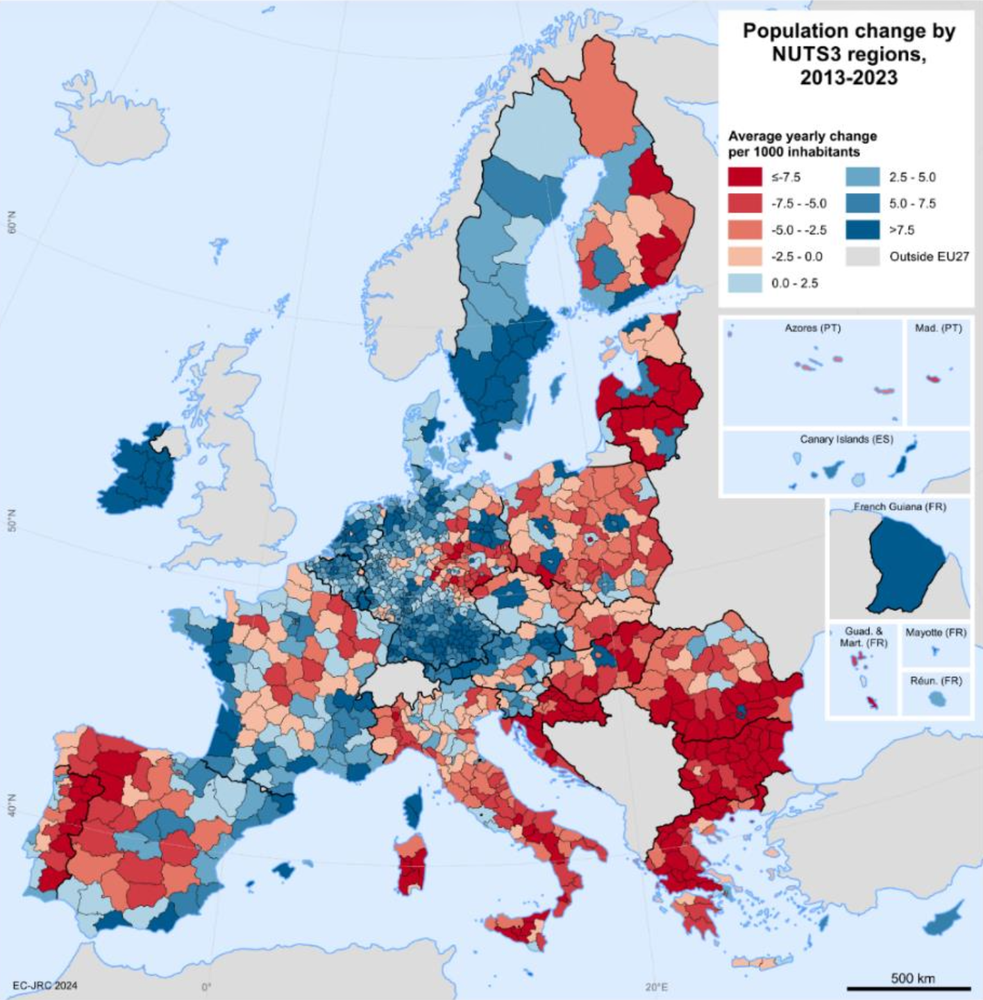
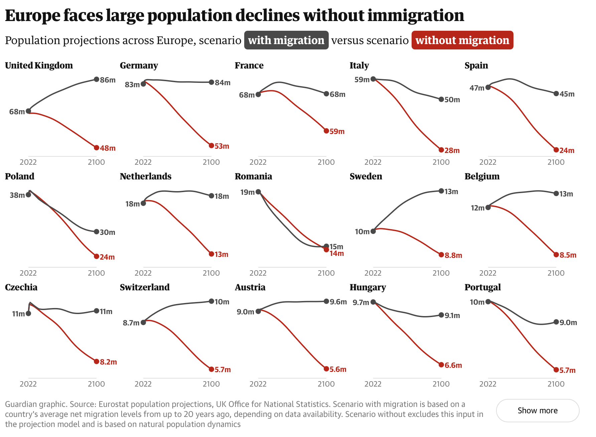
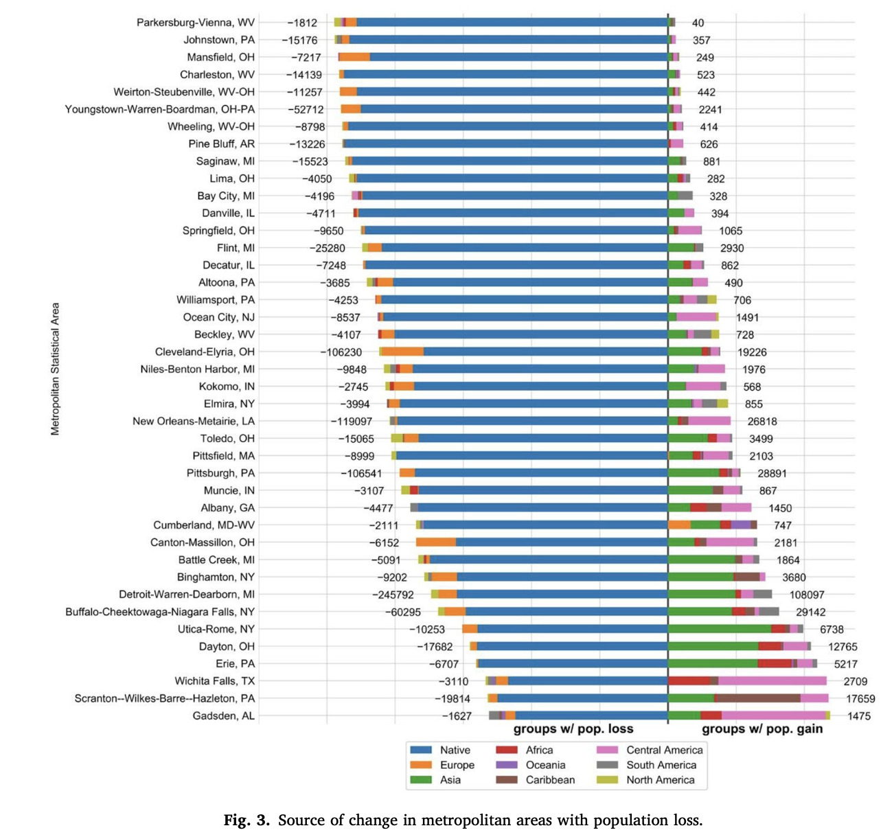
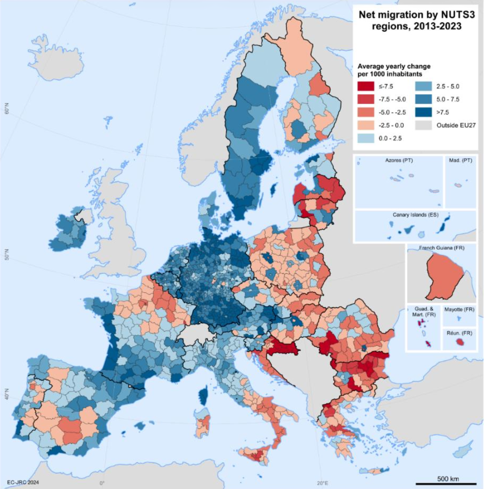
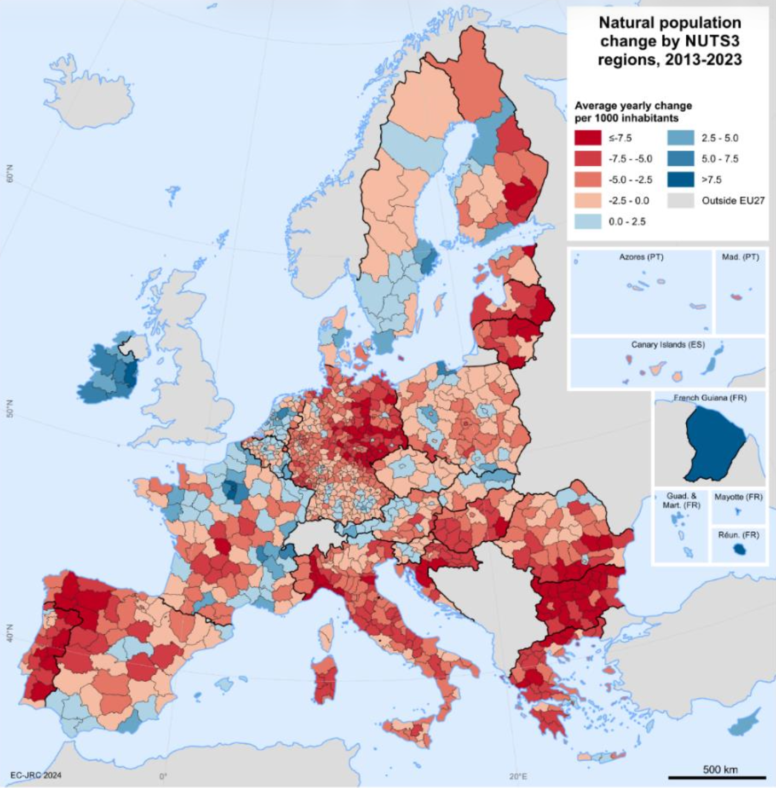
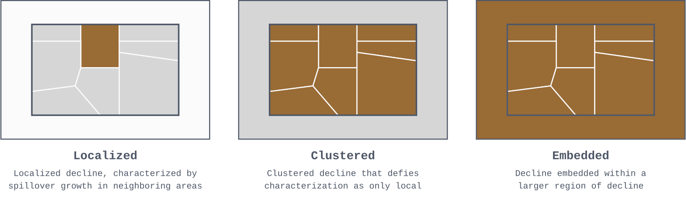

```{r}
#| label: setup
#| include: false

library(ggplot2)
fam <- "Courier Prime"

# text layers: annotate(), geom_text(), geom_label(), ggrepel labels
update_geom_defaults("text",  list(family = fam))
update_geom_defaults("label", list(family = fam))
update_geom_defaults(ggrepel::GeomTextRepel,  list(family = fam))
update_geom_defaults(ggrepel::GeomLabelRepel, list(family = fam))

knitr::opts_chunk$set(dev = "ragg_png")
```

#

Population loss is already a reality for many places and on the horizon for many others. 
I'd like to talk about that. 

#

```{r}
#| label: portugal-lollipop
#| fig-cap: "Population change by NUTS 3 region, Portugal, 2021–2025"
#| fig-width: 8
#| fig-height: 7
#| dev: ragg_png

library(readxl)
library(dplyr)
library(ggplot2)

portugal_data <- read_excel("~/Documents/GitHub/Talks/Finisterra/data/Portugal_21_25.xlsx",
                            sheet = "nuts3") |>
  mutate(loss = change_21_25 < 0)

ink <- "#4e5767"

ggplot(portugal_data) +
  geom_hline(yintercept = 0, colour = ink, linewidth = 0.3) +
  geom_segment(aes(x = Name, xend = Name, y = 0, yend = change_21_25, colour = loss)) +
  geom_point(aes(x = Name, y = change_21_25, size = year25, colour = loss)) +
  scale_colour_manual(values = c(`TRUE` = "#996b35", `FALSE` = "#46859e")) +
  coord_flip() +
  scale_x_discrete(limits = rev) +
  labs(x = NULL,
       y = "Population change (percent), 2021–2025",
       caption = "Source: Eurostat; INE population estimates (revised series).") +
  theme_minimal(base_family = "Courier Prime") +
  theme(text = element_text(colour = ink),
        axis.text = element_text(colour = ink),
        axis.line = element_line(colour = ink),
        plot.background = element_rect(fill = "#fbfbfb", colour = NA),
        panel.background = element_rect(fill = "#fbfbfb", colour = NA),
        panel.grid = element_blank(),
        legend.position = "none",
        plot.caption = element_text(hjust = 0, size = 8))
```

#

{fig-align="center" width="80%"}

#

```{r}
#| label: us-change-2010-20
#| fig-cap: "US county population change, 2010–2020"
#| fig-width: 10
#| fig-height: 5.6

library(readxl)
library(dplyr)
library(sf)
library(tigris)
library(ggplot2)
options(tigris_use_cache = TRUE)

pop <- read_excel("~/Documents/GitHub/Talks/Finisterra/data/US_county_pop_2010_2020.xlsx",
                  sheet = "data", col_types = c("text", "text", "text",
                                                "numeric", "numeric", "numeric"))

counties <- counties(cb = TRUE, year = 2020, resolution = "20m", progress_bar = FALSE) |>
  select(GEOID) |>
  inner_join(pop, by = "GEOID") |>
  st_transform(5070)
stopifnot("Some counties didn't match the boundaries" = nrow(counties) == nrow(pop))

states <- states(cb = TRUE, year = 2020, resolution = "20m", progress_bar = FALSE) |>
  filter(STATEFP %in% substr(pop$GEOID, 1, 2)) |>
  st_transform(5070)

cls <- c("Growth 20% or more", "+10% to 19.9%", "0% to 9.9%",
         "-0.1% to -9.9%", "Decline 10% or more")
pal <- setNames(c("#46859e", "#83a6ab", "#c0d8d0", "#e0b97a", "#996b35"), cls)

counties <- counties |>
  mutate(change = cut(pct_change, breaks = c(-Inf, -10, 0, 10, 20, Inf),
                      right = FALSE, labels = rev(cls)),
         change = factor(change, levels = cls))

n      <- table(counties$change)
labs_n <- paste0(cls, "  (", format(as.integer(n[cls]), big.mark = ",", trim = TRUE), ")")

ink <- "#4e5767"

ggplot() +
  geom_sf(data = counties, aes(fill = change), colour = NA) +
  geom_sf(data = states, fill = NA, colour = "#fbfbfb", linewidth = 0.35) +
  scale_fill_manual(values = pal, labels = labs_n, name = NULL, drop = FALSE) +
  coord_sf(datum = NA) +
  labs(caption = "Source: U.S. Census Bureau; Park, Seymour and Franklin (2026).") +
  theme_void(base_family = "Courier Prime") +
  theme(text = element_text(colour = ink),
        plot.background = element_rect(fill = "#fbfbfb", colour = NA),
        legend.position = "right",
        legend.text     = element_text(size = 11),
        legend.key.size = unit(1.1, "lines"),
        plot.caption    = element_text(hjust = 0, size = 8))
```

# Why care?

## Obvious societal impacts

- Aging
- Economic and fiscal challenges
- Labor market constraints
- Shifting population distribution

## But it's also a pan-societal collective experience

- How our neighborhoods and cities look
- Shifting preferences around family formation and children
- Impacts on politics of immigration, ethnicity, and population growth
- Implications for household wealth (housing)
- Experiential gaps between growing and shrinking areas

# The main premise of my talk is that we talk a lot about the [demographic]{style="background-color: #F0E68C"} aspects of population loss and we should be *also* talking a lot about the [geographic]{style="background-color: #F0E68C"} aspects

# The rest of this talk

[1.]{style="background-color: #F0E68C"} First a quick review of some key demographic aspects

\
\


[2.]{style="background-color: #F0E68C"} Then a deep dive into the geography of population loss

# Demography (very important!)

## How we often think about the causes of population loss

- **Lack of opportunity** (people out-migrate, delay household formation)
- **Cost of living** (pressures to delay or forgo childbearing)
- Economic (and climate and political) **uncertainty**

## But of course proximate sources of population loss are [demographic]{style="background-color: #F0E68C"}

## Globally, there's only one way to grow or shrink

\
\

Natural change: births and deaths

##

```{r}
#| label: tfr-panel
#| fig-cap: "Total fertility rate, selected countries, 1960–2024"
#| fig-width: 10
#| fig-height: 6.5
#| dev: ragg_png

library(readxl)
library(dplyr)
library(ggplot2)

tfr <- read_excel("~/Documents/GitHub/Talks/Finisterra/data/WB_fertility_6countries_1960_2024.xlsx",
                  sheet = "data") |>
  mutate(country = factor(country, levels = c("Kenya", "India", "United States",
                                               "Chile", "Portugal", "South Korea")))

ends <- tfr |> filter(year %in% c(1960, 2024))   # endpoint labels

ink <- "#4e5767"
fam <- "Courier Prime"
region_cols <- c("Sub-Saharan Africa"        = "#D55E00",
                 "South Asia"                = "#E69F00",
                 "North America"             = "#4e5767",
                 "Latin America & Caribbean" = "#009E73",
                 "Europe & Central Asia"     = "#0072B2",
                 "East Asia & Pacific"       = "#56B4E9")

ggplot(tfr, aes(x = year, y = tfr, colour = region)) +
  geom_hline(yintercept = 2.1, linetype = "dotted", colour = ink, linewidth = 0.4) +
  geom_line(linewidth = 1.2) +
  geom_point(data = filter(ends, year == 2024), shape = 21, fill = "#fbfbfb",
             size = 2.5, stroke = 1.2) +
  geom_text(data = filter(ends, year == 1960), aes(label = sprintf("%.2f", tfr)),
            hjust = 0, vjust = -0.9, family = fam, size = 3.3, fontface = "bold",
            show.legend = FALSE) +
  geom_text(data = filter(ends, year == 2024), aes(label = sprintf("%.2f", tfr)),
            hjust = -0.3, family = fam, size = 3.3, fontface = "bold",
            show.legend = FALSE) +
  facet_wrap(~ country, nrow = 2) +
  scale_colour_manual(values = region_cols, guide = "none") +
  scale_x_continuous(breaks = c(1960, 1980, 2000, 2024),
                     labels = c("'60", "'80", "'00", "'24"),
                     expand = expansion(mult = c(0.03, 0.16))) +
  scale_y_continuous(limits = c(0, 8.6), breaks = seq(0, 8, 2)) +
  labs(x = NULL, y = "Births per woman",
       caption = "Dotted line: replacement level (2.1). Source: World Bank, World Development Indicators (https://data.worldbank.org).") +
  theme_minimal(base_family = fam) +
  theme(text = element_text(colour = ink),
        axis.text = element_text(colour = ink),
        strip.text = element_text(colour = ink, face = "bold", size = 12, hjust = 0),
        panel.grid.minor = element_blank(),
        panel.grid.major.x = element_blank(),
        panel.grid.major.y = element_line(colour = "grey88", linewidth = 0.3, linetype = "dotted"),
        panel.spacing = unit(1.2, "lines"),
        plot.background = element_rect(fill = "#fbfbfb", colour = NA),
        plot.caption = element_text(hjust = 0, size = 8))
```

##

```{r}
#| label: fertility-growth
#| fig-cap: "Global Total Fertility Rates and Population Growth Rates, 2024"
#| fig-width: 10
#| fig-height: 7
#| dev: ragg_png

library(readxl)
library(dplyr)
library(ggplot2)
library(ggrepel)

wb <- read_excel("~/Documents/GitHub/Talks/Finisterra/data/WB_fertility_growth_2024.xlsx",
                 sheet = "data") |>
  mutate(region = if_else(iso3 %in% c("PAK", "AFG"), "South Asia", region)) |>
  arrange(desc(population))   # big bubbles drawn first so small ones stay visible

# countries to label: the biggest, plus the outliers
lab_iso <- c("CHN","IND","USA","IDN","PAK","NGA","BRA","JPN","RUS","DEU",
             "KOR","ITA","TCD","SOM","QAT","XKX","MAC","SYR","PRT","ARE")
lab <- filter(wb, iso3 %in% lab_iso)

ink <- "#4e5767"
fam <- "Courier Prime"

ggplot(wb, aes(x = pop_growth, y = tfr)) +
  geom_hline(yintercept = 2.1, colour = ink, linewidth = 0.3) +
  geom_vline(xintercept = 0,   colour = ink, linewidth = 0.3) +
  geom_point(aes(size = population, fill = region),
             shape = 21, colour = "white", stroke = 0.2, alpha = 0.75) +
  geom_text_repel(data = lab, aes(label = country), family = fam,
                  colour = ink, size = 3, min.segment.length = 0.2,
                  segment.colour = "grey60", max.overlaps = Inf, seed = 1) +
  annotate("text", x = -Inf, y = Inf,  label = "MORE BABIES,\nSHRINKING",
           hjust = -0.1, vjust = 1.3, size = 2.8, colour = "grey55", family = fam) +
  annotate("text", x =  Inf, y = Inf,  label = "MORE BABIES,\nGROWING",
           hjust = 1.1,  vjust = 1.3, size = 2.8, colour = "grey55", family = fam) +
  annotate("text", x = -Inf, y = -Inf, label = "FEWER BABIES,\nSHRINKING",
           hjust = -0.1, vjust = -0.5, size = 2.8, colour = "grey55", family = fam) +
  annotate("text", x =  Inf, y = -Inf, label = "FEWER BABIES,\nGROWING",
           hjust = 1.1,  vjust = -0.5, size = 2.8, colour = "grey55", family = fam) +
  annotate("text", x = -Inf, y = 2.1, label = "Replacement (2.1)",
           hjust = -0.1, vjust = -0.5, size = 2.8, colour = ink, family = fam) +
  scale_size_area(max_size = 22, guide = "none") +
  scale_fill_manual(values = c("Sub-Saharan Africa"         = "#D55E00",
                               "South Asia"                 = "#E69F00",
                               "Middle East & North Africa" = "#CC79A7",
                               "East Asia & Pacific"        = "#56B4E9",
                               "Europe & Central Asia"      = "#0072B2",
                               "Latin America & Caribbean"  = "#009E73",
                               "North America"              = "#4e5767"),
                    name = NULL) +
  scale_x_continuous(labels = \(x) paste0(x, "%")) +
  guides(fill = guide_legend(nrow = 2, override.aes = list(size = 4, alpha = 1))) +
  labs(x = "Population growth rate (%), 2024",
       y = "Total fertility rate (births per woman), 2024",
       caption = "Source: World Bank, World Development Indicators (https://data.worldbank.org). Bubble size is population. Styled from https://www.axios.com/population-growth-shrinking-map-adaa01c7-1bb4-44b2-a877-ec75015bd127.html") +
  theme_minimal(base_family = fam) +
  theme(text = element_text(colour = ink),
        axis.text = element_text(colour = ink),
        panel.grid.minor = element_blank(),
        panel.grid.major = element_line(colour = "grey90", linewidth = 0.3),
        plot.background = element_rect(fill = "#fbfbfb", colour = NA),
        legend.position = "top",
        plot.caption = element_text(hjust = 0, size = 8))
```


## For places---countries, regions, and cities---migration really matters

- **Internal** (within an area, like a country)
- **International** (across international borders)

## 

- With prevailing lower fertility rates, growth is fueled by attracting migrants
- Because migrants tend to be younger, when they leave, they take not only themselves (and their skills), they also take any future children they may have

## The importance of international migration should not be underestimated

{fig-align="center" width="80%"}

## Another demographic factor: ageing and age structure

- Lower fertility rates
- But also longer life expectancies (this is a good thing!)
- But creates lots of challenges

## And, of course, demographic composition evolves as depopulation occurs

{fig-align="center" width="50%"}

::: aside

Bagchi-Sen, S., Franklin, R. S., Rogerson, P., & Seymour, E. (2020). Urban inequality and the demographic transformation of shrinking cities: The role of the foreign born. Applied Geography, 116, 102168.

:::

# Now let's talk about geography

# Really two components to the [Depopulation is a Geographical Phenomenon]{style="background-color: #F0E68C"} argument

## [1.]{style="background-color: #F0E68C"} How population loss plays out over space
and how this matters for local areas

##

```{r}
#| label: eu-popchange
#| fig-cap: "Population change by NUTS 3 region, 2021–2025"
#| fig-width: 8
#| fig-height: 8
#| dev: ragg_png

library(readxl)
library(dplyr)
library(sf)
library(giscoR)
library(ggplot2)

eu <- read_excel("~/Documents/GitHub/Talks/Finisterra/data/EU_population_21–25.xlsx",
                 sheet = "total")
  
nuts3 <- gisco_get_nuts(year = "2024", nuts_level = 3,
                        resolution = "10", epsg = "3035") |>
  left_join(eu, by = c("NUTS_ID" = "GEO")) |>
  filter(eu27 == 1)

countries <- gisco_get_nuts(year = "2024", nuts_level = 0,
                            resolution = "10", epsg = "3035")

world <- gisco_get_countries(year = "2024", resolution = "10", epsg = "3035")

lim <- max(abs(nuts3$change_21_25), na.rm = TRUE)

ggplot() +
  geom_sf(data = world, fill = "grey92", colour = NA) +
  geom_sf(data = nuts3, aes(fill = change_21_25), colour = NA) +
  geom_sf(data = countries, fill = NA, colour = "#4e5767", linewidth = 0.2) +
  scale_fill_gradient2(low = "#996b35", mid = "grey95", high = "#46859e",
                     midpoint = 0, limits = c(-6, 6),
                     breaks = c(-6, -3, 0, 3, 6),
                     labels = c("≤ −6", "−3", "0", "3", "≥ 6"),
                     oob = scales::squish, na.value = "grey70",
                     name = "% change") +
  labs(caption = "Source: Eurostat, demo_r_pjanaggr3. NUTS 2024 boundaries © EuroGeographics") +
  coord_sf(xlim = c(2500000, 6000000), ylim = c(1400000, 5400000)) +
  theme_void() +
  theme(text = element_text(family = "Courier Prime", colour = "#4e5767"),
        plot.background = element_rect(fill = "#fbfbfb", colour = NA),
        legend.position = "inside",
        legend.position.inside = c(0.9, 0.7),
        plot.caption = element_text(hjust = 0, size = 8))
```

##

```{r}
#| label: eu-under15-popchange
#| fig-cap: "Under 15 population change by NUTS 3 region, 2021–2025"
#| fig-width: 8
#| fig-height: 8
#| dev: ragg_png

library(readxl)
library(dplyr)
library(sf)
library(giscoR)
library(ggplot2)

eu <- read_excel("~/Documents/GitHub/Talks/Finisterra/data/EU_population_21–25.xlsx",
                 sheet = "under15")

nuts3 <- gisco_get_nuts(year = "2024", nuts_level = 3,
                        resolution = "10", epsg = "3035") |>
  left_join(eu, by = c("NUTS_ID" = "GEO")) |>
  filter(eu27 == 1)

countries <- gisco_get_nuts(year = "2024", nuts_level = 0,
                            resolution = "10", epsg = "3035") |>
  filter(NUTS_ID %in% nuts3$country)

world <- gisco_get_countries(year = "2024", resolution = "10", epsg = "3035")

ggplot() +
  geom_sf(data = world, fill = "grey92", colour = NA) +
  geom_sf(data = nuts3, aes(fill = change_21_25), colour = NA) +
  geom_sf(data = countries, fill = NA, colour = "#4e5767", linewidth = 0.2) +
  scale_fill_gradient2(low = "#996b35", mid = "grey95", high = "#46859e",
                       midpoint = 0, limits = c(-10, 10),
                       breaks = c(-10, -5, 0, 5, 10),
                       labels = c("≤ −10", "−5", "0", "5", "≥ 10"),
                       oob = scales::squish, na.value = "grey70",
                       name = "% change") +
  labs(caption = "Source: Eurostat, demo_r_pjanaggr3. NUTS 2024 boundaries © EuroGeographics") +
  coord_sf(xlim = c(2500000, 6000000), ylim = c(1400000, 5400000)) +
  theme_void() +
  theme(text = element_text(family = "Courier Prime", colour = "#4e5767"),
        plot.background = element_rect(fill = "#fbfbfb", colour = NA),
        legend.position = "inside",
        legend.position.inside = c(0.9, 0.7),
        plot.caption = element_text(hjust = 0, size = 8))
```


##

:::: {.columns}
::: {.column width="50%"}

{fig-align="center"}
:::

::: {.column width="50%"}
{fig-align="center"}

:::
::::

::: aside

TESTORI, G., FRANKLIN, R., SARACENO, P., PERTOLDI, M., PEREA MILLA FERNANDEZ, D. et al., Territories and demographic change - Regional patterns and policy approaches, Publications Office of the European Union, Luxembourg, 2026, https://data.europa.eu/doi/10.2760/4140574, JRC143332.

:::

## [2.]{style="background-color: #F0E68C"} How does geography inform the measurement of population change and understanding of how it's experienced?

## An incomplete list (that I'm still working on)

- Scale
- Context
- Clustering
- Fragmentation
- Centrality / Peripherality
- The urban-rural continuum


## Scale
The choice of units will change our estimates of *where* is shrinking. But also choice of unit should match conceptual expectations of drivers and impacts of loss. 

:::: {.colums}
::: {.column width="50%"}

```{r}
#| label: us-state-change-2010-20
#| fig-cap: "State population change, 2010–2020"
#| fig-width: 10
#| fig-height: 5.6

library(readxl)
library(dplyr)
library(sf)
library(tigris)
library(ggplot2)
options(tigris_use_cache = TRUE)

pop <- read_excel("~/Documents/GitHub/Talks/Finisterra/data/US_county_pop_2010_2020.xlsx",
                  sheet = "data", col_types = c("text", "text", "text",
                                                "numeric", "numeric", "numeric"))

# add counties up to states (contiguous US + DC)
state_pop <- pop |>
  group_by(STATEFP = substr(GEOID, 1, 2)) |>
  summarise(pop_2010 = sum(pop_2010), pop_2020 = sum(pop_2020), .groups = "drop") |>
  mutate(pct_change = (pop_2020 - pop_2010) / pop_2010 * 100)

states <- states(cb = TRUE, year = 2020, resolution = "20m", progress_bar = FALSE) |>
  inner_join(state_pop, by = "STATEFP") |>
  st_transform(5070)
stopifnot("Expected 48 states + DC" = nrow(states) == 49)

cls <- c("Growth 20% or more", "+10% to 19.9%", "0% to 9.9%",
         "-0.1% to -9.9%", "Decline 10% or more")
pal <- setNames(c("#46859e", "#83a6ab", "#c0d8d0", "#e0b97a", "#996b35"), cls)

states <- states |>
  mutate(change = cut(pct_change, breaks = c(-Inf, -10, 0, 10, 20, Inf),
                      right = FALSE, labels = rev(cls)),
         change = factor(change, levels = cls))

n      <- table(states$change)
labs_n <- paste0(cls, "  (", as.integer(n[cls]), ")")

ink <- "#4e5767"

ggplot(states) +
  geom_sf(aes(fill = change), colour = "#fbfbfb", linewidth = 0.4) +
  scale_fill_manual(values = pal, labels = labs_n, name = NULL, drop = FALSE) +
  coord_sf(datum = NA) +
  labs(caption = "Source: U.S. Census Bureau; Park, Seymour and Franklin (2026).") +
  theme_void(base_family = "Courier Prime") +
  theme(text = element_text(colour = ink),
        plot.background = element_rect(fill = "#fbfbfb", colour = NA),
        legend.position = "right",
        legend.text     = element_text(size = 11),
        legend.key.size = unit(1.1, "lines"),
        plot.caption    = element_text(hjust = 0, size = 8))
```

:::

::: {.column width="50%"}

```{r}
#| label: us-change-2010-20-2
#| fig-cap: "County population change, 2010–2020"
#| fig-width: 10
#| fig-height: 5.6

library(readxl)
library(dplyr)
library(sf)
library(tigris)
library(ggplot2)
options(tigris_use_cache = TRUE)

pop <- read_excel("~/Documents/GitHub/Talks/Finisterra/data/US_county_pop_2010_2020.xlsx",
                  sheet = "data", col_types = c("text", "text", "text",
                                                "numeric", "numeric", "numeric"))

counties <- counties(cb = TRUE, year = 2020, resolution = "20m", progress_bar = FALSE) |>
  select(GEOID) |>
  inner_join(pop, by = "GEOID") |>
  st_transform(5070)
stopifnot("Some counties didn't match the boundaries" = nrow(counties) == nrow(pop))

states <- states(cb = TRUE, year = 2020, resolution = "20m", progress_bar = FALSE) |>
  filter(STATEFP %in% substr(pop$GEOID, 1, 2)) |>
  st_transform(5070)

cls <- c("Growth 20% or more", "+10% to 19.9%", "0% to 9.9%",
         "-0.1% to -9.9%", "Decline 10% or more")
pal <- setNames(c("#46859e", "#83a6ab", "#c0d8d0", "#e0b97a", "#996b35"), cls)

counties <- counties |>
  mutate(change = cut(pct_change, breaks = c(-Inf, -10, 0, 10, 20, Inf),
                      right = FALSE, labels = rev(cls)),
         change = factor(change, levels = cls))

n      <- table(counties$change)
labs_n <- paste0(cls, "  (", format(as.integer(n[cls]), big.mark = ",", trim = TRUE), ")")

ink <- "#4e5767"

ggplot() +
  geom_sf(data = counties, aes(fill = change), colour = NA) +
  geom_sf(data = states, fill = NA, colour = "#fbfbfb", linewidth = 0.35) +
  scale_fill_manual(values = pal, labels = labs_n, name = NULL, drop = FALSE) +
  coord_sf(datum = NA) +
  labs(caption = "Source: U.S. Census Bureau; Park, Seymour and Franklin (2026).") +
  theme_void(base_family = "Courier Prime") +
  theme(text = element_text(colour = ink),
        plot.background = element_rect(fill = "#fbfbfb", colour = NA),
        legend.position = "right",
        legend.text     = element_text(size = 11),
        legend.key.size = unit(1.1, "lines"),
        plot.caption    = element_text(hjust = 0, size = 8))
```

:::
::::


## Scale
But even same types of units aren't always comparable 

```{r}
#| label: nuts3-size
#| fig-cap: "These are both NUTS 3 regions"
#| fig-width: 7
#| fig-height: 8

library(readxl)
library(dplyr)
library(sf)
library(giscoR)
library(ggplot2)

ink <- "#4e5767"
highlight_ids <- c("DE736", "ES431")   # Rosenheim (Landkreis), Badajoz

eu <- read_excel("~/Documents/GitHub/Talks/Finisterra/data/EU_population_21–25.xlsx",
                 sheet = "total")

nuts3 <- gisco_get_nuts(year = "2024", nuts_level = 3,
                        resolution = "10", epsg = "3035") |>
  filter(NUTS_ID %in% eu$GEO[eu$eu27 == 1]) |>
  mutate(area_km2 = as.numeric(st_area(geometry)) / 1e6)

hl <- filter(nuts3, NUTS_ID %in% highlight_ids)
stopifnot("A highlight code wasn't found - check highlight_ids" = nrow(hl) == 2)

countries <- gisco_get_nuts(year = "2024", nuts_level = 0,
                            resolution = "10", epsg = "3035") |>
  filter(NUTS_ID %in% nuts3$CNTR_CODE)

world <- gisco_get_countries(year = "2024", resolution = "10", epsg = "3035")

ggplot() +
  geom_sf(data = world, fill = "grey92", colour = NA) +
  geom_sf(data = nuts3, fill = "#fbfbfb", colour = "grey60", linewidth = 0.08) +
  geom_sf(data = countries, fill = NA, colour = ink, linewidth = 0.25) +
  geom_sf(data = hl, fill = "#800020", colour = "#800020", linewidth = 0.3) +
  labs(caption = "NUTS 2024 boundaries © EuroGeographics") +
  coord_sf(xlim = c(2500000, 6000000), ylim = c(1400000, 5400000)) +
  theme_void(base_family = "Courier Prime") +
  theme(text = element_text(colour = ink),
        plot.background  = element_rect(fill = "#fbfbfb", colour = NA),
        panel.background = element_rect(fill = "#fbfbfb", colour = NA),
        plot.caption = element_text(hjust = 0, size = 8))
```

## Context
It also matters what's happening *around* a particular area, whether city, region, or neighborhood

\


{width=100%}

## In the US both growth and decline are largely embedded

```{r}
#| label: us-context-2010-20
#| fig-cap: "US county-level population change in spatial context, 2010–2020"
#| fig-width: 10
#| fig-height: 5.6

library(readxl)
library(dplyr)
library(sf)
library(tigris)
library(ggplot2)
options(tigris_use_cache = TRUE)

decade <- "c_2010_20"   # or c_1950_60, c_1960_70, ... c_2000_10

ctx <- read_excel("~/Documents/GitHub/Talks/Finisterra/data/US_county_context_1950_2020.xlsx",
                  sheet = "data", col_types = "text")

counties <- counties(cb = TRUE, year = 2020, resolution = "20m", progress_bar = FALSE) |>
  select(GEOID) |>
  inner_join(ctx, by = "GEOID") |>
  st_transform(5070)
stopifnot("Some counties didn't match the boundaries" = nrow(counties) == nrow(ctx))

states <- states(cb = TRUE, year = 2020, resolution = "20m", progress_bar = FALSE) |>
  filter(STATEFP %in% substr(ctx$GEOID, 1, 2)) |>
  st_transform(5070)

lab <- c(A = "Regional loss", B = "Localized loss",
         C = "Localized growth", D = "Regional growth")
pal <- c(A = "#996b35", B = "#e0b97a", C = "#c0d8d0", D = "#46859e")

counties <- mutate(counties, class = factor(.data[[decade]], levels = names(pal)))

n      <- table(counties$class)
labs_n <- paste0(lab, "  (", format(as.integer(n[names(pal)]), big.mark = ",", trim = TRUE), ")")

ink <- "#4e5767"

ggplot() +
  geom_sf(data = counties, aes(fill = class), colour = NA) +
  geom_sf(data = states, fill = NA, colour = "#fbfbfb", linewidth = 0.35) +
  scale_fill_manual(values = pal, labels = labs_n, name = NULL, drop = FALSE) +
  coord_sf(datum = NA) +
  labs(caption = "Class combines each county's change with its neighbors' (population-weighted) change.\nSource: Park, Seymour and Franklin (2026).") +
  theme_void(base_family = "Courier Prime") +
  theme(text = element_text(colour = ink),
        plot.background = element_rect(fill = "#fbfbfb", colour = NA),
        legend.position = "right",
        legend.text     = element_text(size = 11),
        legend.key.size = unit(1.1, "lines"),
        plot.caption    = element_text(hjust = 0, size = 8))
```

## Clustering
When an area is losing population, how evenly distributed is the loss? Are shrinking areas close to other shrinking areas?

##

```{r}
#| label: lisa-setup
#| include: false

library(spdep)

lisa_classes <- function(x, var, alpha = 0.05) {
  set.seed(2026)
  nb  <- poly2nb(x, queen = TRUE)
  iso <- which(card(nb) == 0)
  if (length(iso)) {                       # islands: borrow their 3 nearest regions
    knn <- knn2nb(knearneigh(st_coordinates(st_point_on_surface(st_geometry(x))), k = 3))
    for (i in iso) nb[[i]] <- knn[[i]]
    nb <- make.sym.nb(nb)
  }
  lm   <- localmoran_perm(x[[var]], nb2listw(nb, style = "W"), nsim = 999)
  quad <- as.character(attr(lm, "quadr")$mean)
  p    <- lm[, "Pr(z != E(Ii)) Sim"]
  factor(ifelse(p < alpha, quad, "Not significant"),
         levels = c("High-High", "Low-Low", "Low-High", "High-Low", "Not significant"))
}

lisa_pal  <- c("High-High" = "#46859e", "Low-Low" = "#996b35", "Low-High" = "#e0b97a",
               "High-Low" = "#c0d8d0", "Not significant" = "#e4e4e4")
lisa_labs <- c("High-High" = "Growth cluster (high-high)",
               "Low-Low"   = "Loss cluster (low-low)",
               "Low-High"  = "Low amid high (low-high)",
               "High-Low"  = "High amid low (high-low)",
               "Not significant" = "Not significant")
```

```{r}
#| label: lisa-eu
#| fig-cap: "Local Moran's I map of population change, NUTS 3 regions, 2021–2025"
#| fig-width: 10
#| fig-height: 8

library(readxl)
library(dplyr)
library(sf)
library(giscoR)
library(ggplot2)

ink <- "#4e5767"

eu <- read_excel("~/Documents/GitHub/Talks/Finisterra/data/EU_population_21–25.xlsx",
                 sheet = "total")

nuts3 <- gisco_get_nuts(year = "2024", nuts_level = 3,
                        resolution = "10", epsg = "3035") |>
  inner_join(eu, by = c("NUTS_ID" = "GEO")) |>
  filter(eu27 == 1, !is.na(change_21_25),
         !grepl("^FRY|^PT2|^PT3|^ES70", NUTS_ID))   # outermost regions, off the map
nuts3$lisa <- lisa_classes(nuts3, "change_21_25")

countries <- gisco_get_nuts(year = "2024", nuts_level = 0,
                            resolution = "10", epsg = "3035") |>
  filter(NUTS_ID %in% nuts3$country)
world <- gisco_get_countries(year = "2024", resolution = "10", epsg = "3035")

ggplot() +
  geom_sf(data = world, fill = "grey92", colour = NA) +
  geom_sf(data = nuts3, aes(fill = lisa), colour = NA) +
  geom_sf(data = countries, fill = NA, colour = ink, linewidth = 0.2) +
  scale_fill_manual(values = lisa_pal, labels = lisa_labs, name = NULL, drop = FALSE) +
  coord_sf(xlim = c(2500000, 6000000), ylim = c(1400000, 5400000), datum = NA) +
  labs(caption = "Local Moran's I on 2021-25 change; neighbors share a border; 999 permutations, p < 0.05.\nSource: Eurostat, demo_r_pjanaggr3. NUTS 2024 boundaries © EuroGeographics") +
  theme_void(base_family = "Courier Prime") +
  theme(text = element_text(colour = ink),
        plot.background = element_rect(fill = "#fbfbfb", colour = NA),
        legend.position = "right",
        legend.text     = element_text(size = 11),
        legend.key.size = unit(1.1, "lines"),
        plot.caption    = element_text(hjust = 0, size = 8))
```

##

```{r}
#| label: lisa-us
#| fig-cap: "Local Moran's I of population change, US counties, 2010–2020"
#| fig-width: 10
#| fig-height: 5.6

library(readxl)
library(dplyr)
library(sf)
library(tigris)
library(ggplot2)
options(tigris_use_cache = TRUE)

ink <- "#4e5767"

pop <- read_excel("~/Documents/GitHub/Talks/Finisterra/data/US_county_pop_2010_2020.xlsx",
                  sheet = "data", col_types = c("text", "text", "text",
                                                "numeric", "numeric", "numeric"))

us <- counties(cb = TRUE, year = 2020, resolution = "20m", progress_bar = FALSE) |>
  select(GEOID) |>
  inner_join(pop, by = "GEOID") |>
  st_transform(5070)
us$lisa <- lisa_classes(us, "pct_change")

states <- states(cb = TRUE, year = 2020, resolution = "20m", progress_bar = FALSE) |>
  filter(STATEFP %in% substr(pop$GEOID, 1, 2)) |>
  st_transform(5070)

ggplot() +
  geom_sf(data = us, aes(fill = lisa), colour = NA) +
  geom_sf(data = states, fill = NA, colour = "#fbfbfb", linewidth = 0.35) +
  scale_fill_manual(values = lisa_pal, labels = lisa_labs, name = NULL, drop = FALSE) +
  coord_sf(datum = NA) +
  labs(caption = "Local Moran's I on 2010-20 change; neighbors share a border; 999 permutations, p < 0.05.\nSource: U.S. Census Bureau; Park, Seymour and Franklin (2026).") +
  theme_void(base_family = "Courier Prime") +
  theme(text = element_text(colour = ink),
        plot.background = element_rect(fill = "#fbfbfb", colour = NA),
        legend.position = "right",
        legend.text     = element_text(size = 11),
        legend.key.size = unit(1.1, "lines"),
        plot.caption    = element_text(hjust = 0, size = 8))
```

## Fragmentation
An alternative way of understanding the configuration of loss within an area, borrowing from ecological habitat fragmentation

##

```{r}
#| label: clumpy-viseu
#| fig-cap: "Fragmentation of population loss at 1 km, central Portugal, 2011–2021"
#| fig-width: 7
#| fig-height: 7.6

library(data.table)
library(sf)
library(giscoR)
library(ggplot2)
library(patchwork)

ink    <- "#4e5767"
centre <- c(E = 2815, N = 2131)   # Viseu, in km on the EU grid (EPSG:3035)
half   <- 25                      # 50 x 50 km window

cells <- fread("~/Documents/GitHub/Talks/Finisterra/data/geostat_cells_PT.csv.gz")   # mainland Portugal only
cells[, loss := p21 < p11]

# CLUMPY for mainland Portugal (FRAGSTATS definition, 4-neighbour adjacency)
clumpy <- function(d) {
  key  <- d$N * 100000L + d$E
  lk   <- key[d$loss]
  hit  <- match(c(lk + 100000L, lk - 100000L, lk + 1L, lk - 1L), key)
  hit  <- hit[!is.na(hit)]
  g_ii <- sum(d$loss[hit]); g_ik <- sum(!d$loss[hit])
  n <- sum(d$loss); P <- n / nrow(d)
  s <- floor(sqrt(n))
  min_e <- if (n == s^2) 4 * s else if (n <= s * (s + 1)) 4 * s + 2 else 4 * s + 4
  G <- g_ii / (g_ii + g_ik - min_e)
  if (G < P && P < 0.5) (G - P) / P else (G - P) / (1 - P)
}
pt_clumpy <- clumpy(cells)

win <- cells[abs(E - centre["E"]) <= half & abs(N - centre["N"]) <= half]
win[, change := factor(ifelse(loss, "Lost population", "Gained population"),
                       levels = c("Lost population", "Gained population"))]
xlim <- (centre["E"] + c(-half, half + 1)) * 1000
ylim <- (centre["N"] + c(-half, half + 1)) * 1000

pt <- gisco_get_nuts(year = "2024", nuts_level = 0, resolution = "10",
                     epsg = "3035", country = "PT")
viseu <- st_sfc(st_point(centre * 1000 + 500), crs = 3035)

close_up <- ggplot() +
  geom_sf(data = pt, fill = "grey92", colour = NA) +
  geom_tile(data = win, aes(x = E * 1000 + 500, y = N * 1000 + 500, fill = change),
            width = 1000, height = 1000, colour = "#fbfbfb", linewidth = 0.15) +
  geom_sf_label(data = viseu, label = "Viseu", family = "Courier Prime",
                colour = ink, fill = "#fbfbfb", size = 4, fontface = "bold",
                label.size = 0, label.padding = unit(0.15, "lines")) +
  scale_fill_manual(values = c("Lost population" = "#996b35",
                               "Gained population" = "#46859e"), name = NULL) +
  coord_sf(xlim = xlim, ylim = ylim, datum = NA, expand = FALSE) +
  theme_void(base_family = "Courier Prime") +
  theme(text = element_text(colour = ink),
        panel.border = element_rect(fill = NA, colour = ink, linewidth = 0.4),
        legend.position = "bottom",
        legend.text = element_text(size = 11))

box <- st_as_sfc(st_bbox(c(xmin = xlim[[1]], xmax = xlim[[2]], ymin = ylim[[1]], ymax = ylim[[2]]),
                         crs = st_crs(3035)))
locator <- ggplot() +
  geom_sf(data = pt, fill = "grey85", colour = NA) +
  geom_sf(data = box, fill = NA, colour = "#996b35", linewidth = 0.8) +
  coord_sf(xlim = c(2630000, 3000000), ylim = c(1730000, 2335000), datum = NA, expand = FALSE) +
  theme_void()

close_up + locator + plot_layout(widths = c(4, 1)) +
  plot_annotation(caption = sprintf(paste0(
    "50 x 50 km around Viseu; 1 km cells with at least 10 residents in 2011 and 2021.\n",
    "%d of %d cells lost population. Empty squares: no residents, or fewer than 10 in either year.\n", 
    "CLUMPY, mainland Portugal: %.2f (0 = random).\n",
    "Source: Eurostat GEOSTAT 2011 and Census 2021 population grids."),
    sum(win$loss), nrow(win), pt_clumpy)) &
  theme(plot.background = element_rect(fill = "#fbfbfb", colour = NA),
        plot.caption = element_text(hjust = 0, size = 8, family = "Courier Prime", colour = ink))
```

## Centrality / Peripherality
Especially in an urban context, one question is the extent to which loss is happening in the core or edges of the city (or in between)

##

```{r}
#| label: city-hall-rings
#| fig-cap: "Population change by distance from city hall, 2010–2020"
#| fig-width: 10
#| fig-height: 6

library(data.table)
library(ggplot2)

ink <- "#4e5767"
metros <- c("19820" = "Detroit", "17460" = "Cleveland", "38300" = "Pittsburgh",
            "15380" = "Buffalo",  "16980" = "Chicago",   "26420" = "Houston")

rings <- fread("~/Documents/GitHub/Talks/Finisterra/data/city_hall_rings_bg_halfmi_2010_2020.csv", colClasses = c(CBSA = "character"))
rings <- rings[CBSA %in% names(metros) & miles_to <= 30]
rings[, metro := factor(metros[CBSA], levels = metros)]
rings[, direction := ifelse(pct_change < 0, "Loss", "Growth")]

ggplot(rings, aes(x = miles_from + 0.25, y = pct_change, fill = direction)) +
  geom_hline(yintercept = 0, colour = ink, linewidth = 0.3) +
  geom_col(width = 0.42) +
  facet_wrap(~ metro, nrow = 2) +
  scale_fill_manual(values = c(Loss = "#996b35", Growth = "#46859e"), guide = "none") +
  scale_x_continuous(breaks = c(0, 10, 20, 30), expand = expansion(mult = 0.01)) +
  scale_y_continuous(labels = \(x) paste0(x, "%")) +
  coord_cartesian(ylim = c(-20, 40)) +   # a few bars run past 40% and are cut off
  labs(x = "Miles from city hall", y = "Population change, 2010-2020",
       caption = "Block groups grouped into half-mile rings around the city hall of each metro's principal city (2010 geography). Bars cut off at 40%.\nSource: IPUMS NHGIS (Schroeder et al. 2026), 2010 and 2020 censuses standardized to 2010 block groups.") +
  theme_minimal(base_family = "Courier Prime") +
  theme(text = element_text(colour = ink),
        axis.text = element_text(colour = ink),
        strip.text = element_text(colour = ink, face = "bold", size = 12, hjust = 0),
        panel.grid.minor = element_blank(),
        panel.grid.major.x = element_blank(),
        panel.grid.major.y = element_line(colour = "grey88", linewidth = 0.3),
        panel.spacing = unit(1.2, "lines"),
        plot.background = element_rect(fill = "#fbfbfb", colour = NA),
        plot.caption = element_text(hjust = 0, size = 8))
```

## Urban-rural continuum
In a national or regional context, where is loss occurring? Is it a remote rural issue, an urban issue? 

##

```{r loss-concentration-all}
#| echo: false
#| message: false
#| warning: false
#| fig-width: 11
#| fig-height: 6.5
#| fig-align: center
library(data.table)
library(ggplot2)
library(ggrepel)

ink <- "#4e5767"

d <- fread("~/Documents/GitHub/Talks/Finisterra/data/degurba_loss_concentration.csv")
d[, class_label := factor(class_label, levels = rev(c("City", "Dense town", "Semi-dense town", "Suburb",
                                                      "Village", "Low-density rural", "Very low-density rural")))]
d[, direction := ifelse(lci > 1, "More", "Less")]
med  <- d[, .(lci = median(lci)), by = class_label]
ends <- d[, .SD[c(which.min(lci), which.max(lci))], by = class_label]   # label only the extremes

ggplot(d, aes(x = lci, y = class_label)) +
  geom_vline(xintercept = 1, colour = ink, linewidth = 0.3) +
  geom_point(data = med, shape = 124, size = 9, colour = ink) +            # median across countries
  geom_point(aes(colour = direction), size = 2.6, alpha = 0.85) +
  geom_text_repel(data = ends, aes(label = country, colour = direction), family = "Courier Prime", size = 3.2,
                  direction = "y", nudge_y = 0.3, segment.size = 0.2, segment.colour = "grey70",
                  min.segment.length = 0.2, box.padding = 0.12, max.overlaps = Inf, seed = 2026) +
  scale_colour_manual(values = c(More = "#996b35", Less = "#46859e"), guide = "none") +
  scale_x_continuous(trans = "log2", breaks = c(0.125, 0.25, 0.5, 1, 2, 4, 8),
                     labels = c("1/8", "1/4", "1/2", "1", "2", "4", "8"),
                     limits = c(0.1, 7)) +
  labs(x = "Share of gross population loss / share of 2011 population (log scale)", y = NULL,
       caption = "Each dot is one of 15 countries with consistent 2011 and 2021 grids; labels show the lowest and highest; bar = median.\nAbove 1: loss concentrated in that class. Gross loss = population lost in 1 km cells that declined, 2011-2021\n(cells with 10+ residents in 2011). Cells classified by the Degree of Urbanisation (level 2), 2011 population.\nSource: Eurostat GEOSTAT 2011 and Census 2021 population grids.") +
  theme_minimal(base_family = "Courier Prime") +
  theme(text = element_text(colour = ink),
        axis.text = element_text(colour = ink, size = 11),
        panel.grid.minor = element_blank(),
        panel.grid.major.y = element_line(colour = "grey92", linewidth = 0.3),
        panel.grid.major.x = element_line(colour = "grey88", linewidth = 0.3),
        plot.background = element_rect(fill = "#fbfbfb", colour = NA),
        plot.caption = element_text(hjust = 0, size = 8))
```

##

```{r urban-rural}
#| echo: false
#| message: false
#| warning: false
#| fig-width: 11
#| fig-height: 6.5
#| fig-align: center
library(data.table)
library(ggplot2)

ink  <- "#4e5767"
show <- c("PT", "DE", "FR", "FI", "LT", "IE")   # countries with consistent 2011 and 2021 grids

d <- fread("~/Documents/GitHub/Talks/Finisterra/data/degurba_change_2011_2021.csv")[cc %in% show & consistent_grid == TRUE]
d[, country := factor(country, levels = unique(country[match(show, cc)]))]
d[, class_label := factor(class_label, levels = rev(c("City", "Dense town", "Semi-dense town", "Suburb",
                                                      "Village", "Low-density rural", "Very low-density rural")))]
d[, direction := ifelse(pct_change < 0, "Loss", "Growth")]

ggplot(d, aes(x = pct_change, y = class_label, fill = direction)) +
  geom_vline(xintercept = 0, colour = ink, linewidth = 0.3) +
  geom_col(width = 0.75) +
  facet_wrap(~ country, nrow = 2) +
  scale_fill_manual(values = c(Loss = "#996b35", Growth = "#46859e"), guide = "none") +
  scale_x_continuous(labels = \(x) paste0(x, "%")) +
  labs(x = "Population change, 2011-2021", y = NULL,
       caption = "1 km grid cells classified by the Degree of Urbanisation (level 2) using 2011 population; change summed over all cells in each class.\nSource: Eurostat GEOSTAT 2011 and Census 2021 population grids.") +
  theme_minimal(base_family = "Courier Prime") +
  theme(text = element_text(colour = ink),
        axis.text = element_text(colour = ink),
        strip.text = element_text(colour = ink, face = "bold", size = 12, hjust = 0),
        panel.grid.minor = element_blank(),
        panel.grid.major.y = element_blank(),
        panel.grid.major.x = element_line(colour = "grey88", linewidth = 0.3),
        panel.spacing = unit(1.2, "lines"),
        plot.background = element_rect(fill = "#fbfbfb", colour = NA),
        plot.caption = element_text(hjust = 0, size = 8))
```

# Closing thoughts
Where does this leave us?

## Some aspects of depopulation are probably here to stay

- Aging
- Below-replacement level fertility
- Housing challenges that don't evaporate with decline
- Transport demand might not either
- Regional and global interdependence
- Uncertainty

## Different kinds of loss demand different kinds of policy responses
And both demographic and geographic considerations are important

## Demographic

- Helping individuals reach desired family size
- The role of immigration policy


## Geographic

- Helping individuals reach desired residential location (staying, going...)
- Balancing challenges of growth and loss within the same national context
- How extensive is loss? Where is it happening and how scale-dependent is it? Where in the area is it occurring and are all sub-areas equally affected?

# The End.

\

Thank you!!

